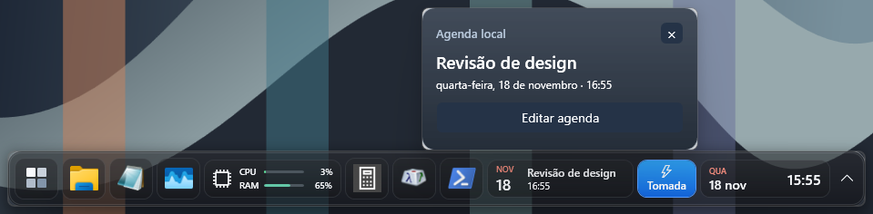
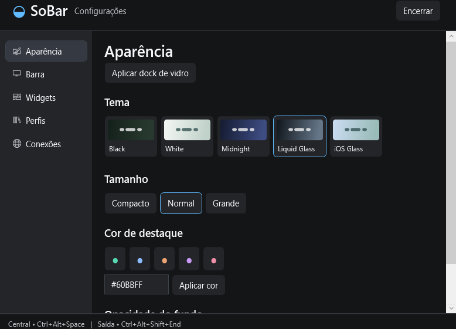

# SoBar

Dock flutuante para Windows, escrito em C# com .NET 10 e WPF. Ícones de aplicativos e cartões interativos ficam em uma faixa de vidro centralizada. O primeiro botão abre a pesquisa e a seta abre o menu de opções. O dock convive com a barra original do Windows.



A captura usa um fundo de teste, ícones nativos do Windows e um compromisso de exemplo no perfil temporário. O cartão de CPU e memória é uma opção de layout. Na primeira execução normal, esse espaço traz o cartão de limites do Codex, que solicita conexão.

## Instalar e usar

1. Baixe o MSI x64 na [página de versões](https://github.com/SoEuzinho/SoBar/releases). Execute o arquivo e abra **SoBar** no menu Iniciar. Para usar a edição portátil, extraia o ZIP inteiro e execute **SoBar.exe**.
2. Clique em um aplicativo para alternar entre janelas. Abra o menu de contexto do botão para fixar o aplicativo ou acessar as ações disponíveis.
3. Em **Configurações → Widgets**, adicione itens, arraste para reordenar e ajuste a escala. Em **Aparência**, escolha tema, tamanho, opacidade e cor. Em **Barra**, escolha monitor, posição, agrupamento e ocultação.
4. Use **Ctrl+Alt+Espaço** para pesquisar aplicativos do menu Iniciar e arquivos em Documentos ou na Área de Trabalho. O atalho é configurável. A central também oferece comandos locais e um assistente opcional.
5. Se você atualizou da versão 0.1.0, escolha **Aparência → Aplicar dock de vidro** para usar o conjunto da referência. Os aplicativos fixados continuam na barra.

**Saída de emergência:** pressione **Ctrl+Alt+Shift+End** ou escolha **Encerrar o SoBar** no menu do botão SoBar. Para remover a edição instalada, use **Aplicativos instalados** do Windows. Os dados pessoais ficam em `%LOCALAPPDATA%\SoBar`.



## Recursos desta versão

- Aplicativos fixados e abertos, ícones do Shell, indicação de foco, agrupamento e miniaturas DWM.
- Barra em um ou vários monitores, ajuste por DPI, reserva opcional da área de trabalho, ocultação automática e detecção de tela cheia.
- Cinco estilos, três tamanhos, editor de widgets com grupos nomeados, [perfis automáticos por aplicativo e monitor](docs/CONTEXT-PROFILES.md), importação e exportação de configurações.
- 23 widgets, incluindo agenda local, cartão duplo de CPU e RAM, energia, relógio com clima, tempo de tela opcional e janelas de uso do Codex. O catálogo das configurações filtra por nome ou categoria. [Fontes de dados e permissões](docs/WIDGETS.md) · [Cobertura dos 109 cartões da referência](docs/CATALOGO.md)
- Pesquisa local e histórico opcional. O assistente só envia a pergunta ao acionar **Enviar**. Ações sugeridas passam por uma lista de operações permitidas e exigem confirmação. As chaves são protegidas pela DPAPI da conta Windows.
- Extensões declarativas com manifesto versionado, prévia das permissões e verificação em processo auxiliar. [Como criar uma extensão](docs/PLUGINS.md)

Para atualizar pelo aplicativo, coloque o MSI da versão mais recente e seu arquivo `.msi.sig` na mesma pasta. Abra **Configurações → Conexões → Selecionar atualização**. O SoBar verifica a assinatura e a versão antes de iniciar o Windows Installer. A assinatura destacada pertence ao atualizador do projeto. A distribuição de prévia não possui assinatura comercial Authenticode.

## Compilar e testar

Use Windows x64, SDK .NET 10 e PowerShell 7 para os scripts de distribuição.

```powershell
dotnet build SoBar.sln -c Release
dotnet test SoBar.sln -c Release --no-build
dotnet run --project src/SoBar.App -c Release
```

O smoke test abre a interface com dados temporários e encerra sozinho.

```powershell
dotnet run --project src/SoBar.App -c Release -- --smoke-test
./scripts/Publish.ps1
```

O script de publicação produz o portátil e o MSI em `artifacts/release`. A opção `-Sign` requer a chave CNG correspondente à identidade pública incorporada. O SDK e o WiX são necessários apenas na máquina de compilação. Consulte o [registro de validação](docs/VALIDATION.md), a [compatibilidade por edição do Windows](docs/COMPATIBILITY.md) e os [componentes de terceiros](docs/THIRD_PARTY.md).

## Desenvolvimento

A solução divide interface, contratos, integração nativa, widgets, extensões e infraestrutura em seis projetos. O histórico de desenvolvimento e as próximas prioridades estão na [análise comparativa](docs/LUMABAR_FEATURE_ANALYSIS.md) e no [roadmap de widgets e módulos](docs/ROADMAP.md). As regras de contribuição estão em [AGENTS.md](AGENTS.md).
